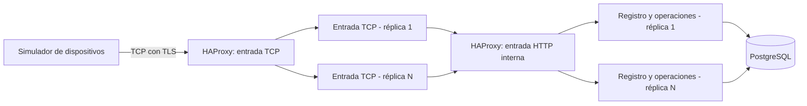

# TFM: Pasarela IoT escalable sobre TCP persistente

Documento de requisitos, arquitectura y contrato de implementación.

Máster en Desarrollo con IA E.1 - BigSchool. Fecha: 15 de octubre de 2026.

Estado: especificación inicial consolidada. No representa una aplicación ya implementada ni resultados de rendimiento obtenidos.

## 1. Contexto, objetivo y restricciones

El alumno es ingeniero técnico informático y trabaja desarrollando una pasarela de pagos. Tiene experiencia con C++, C#, Git y, recientemente, .NET. El TFM desarrollará una implementación propia inspirada en el problema de comunicación dispositivo-servidor, sin reproducir código, protocolos privados ni información de su empresa.

El objetivo es construir una pasarela que reciba conexiones TCP persistentes de dispositivos IoT simulados, valide sus mensajes y su registro, ejecute operaciones sencillas y conserve trazabilidad en una base de datos independiente. Los dos servicios de aplicación deben poder replicarse y escalar manualmente.

Condiciones confirmadas:

- Matrícula particular, sin FUNDAE. Prioridad: entregar lo antes posible con un alcance completo y asumible.
- Presupuesto máximo total para completar el proyecto: **100 EUR**, no 100 EUR mensuales.
- Dedicación semanal variable. No se fija una fecha de finalización sin conocer el avance real.
- Se utilizarán Docker y un repositorio publicable en GitHub.
- Se desarrollará también un simulador con cientos o miles de dispositivos configurables.
- No habrá pagos reales, pasarelas bancarias ni procesamiento financiero.
- No se exige autoescalado. El aumento manual de réplicas es suficiente; una política por días u horarios puede añadirse después.
- Equipos disponibles: Synology DS920+ y mini PC CHUWI LarkBox X, Intel N150, 16 GB de RAM, SSD de 512 GB y Proxmox instalado.
- Suscripciones disponibles: ChatGPT y Gemini. El funcionamiento de la aplicación no dependerá de una API de IA de pago.

Las decisiones técnicas añadidas en este documento concretan los aspectos que el alumno ha delegado. Son revisables mediante una decisión documentada y actualizando el contrato y sus pruebas.

## 2. Alcance de la primera entrega

### Incluido

1. Servicio de entrada TCP persistente, asíncrono, con validación de formato y límites.
2. Servicio de registro y operaciones, con acceso exclusivo a la base de datos.
3. Base de datos independiente con dispositivos, comercios, conexiones, mensajes, operaciones y totales.
4. Protocolo propio versionado, solicitudes y respuestas correlacionadas.
5. Inicialización, suma matemática y consulta de totales por dispositivo.
6. Autenticación e integridad mediante HMAC por dispositivo y transporte TLS.
7. Registro de conexiones y de los datos recibidos, con tratamiento explícito de errores y límites de auditoría.
8. Simulador configurable y escenarios de carga, errores, desconexión y reintento.
9. Réplicas configurables, balanceo, comprobaciones de salud y prueba de caída de una réplica.
10. Instalación reproducible, pruebas, documentación, presentación y demostración.

### Fuera de esta primera entrega

- Pagos reales, certificaciones financieras y tratamiento de datos de tarjetas.
- Interfaz gráfica de administración. El alta inicial se realizará mediante una herramienta de aprovisionamiento.
- Kubernetes, broker de mensajería, caché distribuida, aprendizaje automático y entrenamiento de modelos.
- Alta disponibilidad completa de PostgreSQL, del balanceador o del servidor físico.
- Migración transparente de una conexión TCP abierta de una réplica a otra.
- Autoescalado basado en métricas. El escalado por calendario será una mejora opcional.

## 3. Arquitectura

Se conservan **tres componentes funcionales**: entrada, registro/operaciones y base de datos. El balanceador es infraestructura adicional necesaria para distribuir tráfico; el simulador y las herramientas de aprovisionamiento/pruebas son clientes auxiliares.



Las dos entradas de HAProxy pertenecen inicialmente a una única instancia. Su entrada HTTP solo está disponible en la red interna de contenedores.

### Responsabilidades

| Componente | Responsabilidades | Estado conservado |
|---|---|---|
| Entrada TCP (`gateway`) | Aceptar conexiones, TLS, delimitar mensajes, validar estructura, mantener identidad de sesión, aplicar límites y devolver respuestas | Conexiones y sesión en memoria; logs operativos. Sin acceso a PostgreSQL ni secretos HMAC de dispositivos |
| Registro y operaciones (`registry`) | Consultar dispositivo, verificar HMAC, validar estado y reloj, ejecutar acciones, firmar respuestas, registrar auditoría y asegurar idempotencia | Estado funcional en PostgreSQL; no depender de sesiones locales |
| PostgreSQL (`db`) | Registro de dispositivos/comercios, persistencia, restricciones, operaciones, totales y auditoría | Volumen persistente |
| HAProxy (`proxy`) | Distribuir nuevas conexiones TCP y peticiones HTTP internas entre réplicas saludables | Estado operativo del balanceador |
| Simulador | Generar dispositivos y tráfico, verificar respuestas, reconectar, reintentar y medir | Configuración, claves de prueba y resultados locales |

### Stack elegido

- C# y **.NET 10 LTS**, con el parche soportado disponible cuando se implemente. La elección evita iniciar el proyecto en una versión próxima al fin de soporte. [Política oficial de .NET](https://dotnet.microsoft.com/en-us/platform/support/policy).
- Generic Host y sockets asíncronos para la entrada; `SslStream` para TLS.
- ASP.NET Core para la API interna del servicio de registro.
- PostgreSQL 18, Npgsql y EF Core compatibles con la versión elegida de .NET. SQL explícito donde ayude a controlar una actualización atómica. Se fijarán versiones concretas al crear el proyecto.
- Docker Compose para despliegue y ajuste manual de réplicas.
- HAProxy Community para balanceo TCP y HTTP interno. Se comprobará la resolución de las réplicas mediante DNS de Docker en las pruebas de integración.
- xUnit para pruebas y GitHub Actions para compilación y validación automatizada.

No se necesita incorporar IA al tráfico del dispositivo. Su uso en el desarrollo se documentará con decisiones, reglas de trabajo, revisión de código y pruebas.

## 4. Identidad y reglas generales

| Campo | Formato | Regla |
|---|---|---|
| Fabricante | 2 dígitos ASCII | `00` a `99` |
| Modelo | 2 dígitos ASCII | `00` a `99` |
| Número de serie | 11 dígitos ASCII | Mantener ceros iniciales |
| Fecha y hora | 10 dígitos, `yyMMddHHmm` | UTC, reloj de 24 horas |
| Acción | 3 dígitos ASCII | `001`, `002` o `003` |
| Resultado | 3 dígitos ASCII | Catálogo del apartado 8 |
| Comercio | 9 dígitos ASCII | Identificador devuelto tras autenticar correctamente un dispositivo registrado |

La identidad única es la combinación **fabricante + modelo + número de serie**. Los identificadores se almacenarán como cadenas con longitud y contenido restringidos; no como enteros, para conservar los ceros iniciales.

Se interpreta la fecha propuesta por el alumno como `yyMMddHHmm`: `HH` representa 00–23 y `mm` los minutos. Para evitar ambigüedad de siglo, la versión 1 admite años 2000–2099. PostgreSQL conservará también la fecha de recepción del servidor con precisión completa y zona horaria.

`000000000` queda reservado como comercio no disponible; no se asignará a un comercio real del simulador.

## 5. Protocolo IoT v1

### 5.1 Transporte y separación de mensajes

- TCP persistente protegido con TLS. Perfil de demostración: TLS 1.2 o superior, validación de certificado y nombre del servidor.
- Cada mensaje es una línea **ASCII**, sin BOM, terminada en un único byte LF (`0x0A`). CRLF no es válido en v1.
- Campos separados por `|`. Ningún campo puede contener `|`, CR, LF o bytes fuera del ASCII permitido.
- Tamaño máximo de una trama: **4096 bytes incluyendo LF**.
- El receptor acumula bytes hasta LF. Una lectura TCP puede contener media trama, una trama o varias; nunca se asumirá que una lectura equivale a un mensaje.
- El emisor escribe la trama completa, gestionando escrituras parciales cuando la API empleada lo requiera.
- Una trama demasiado larga o una transmisión incompleta que supere su plazo provoca el cierre de la conexión, evitando consumir memoria sin límite.
- Una petición pendiente por conexión. El simulador puede tener miles de conexiones, pero cada dispositivo espera su respuesta antes de enviar la siguiente petición.
- Las peticiones completas consecutivas recibidas juntas se procesan en orden; no se ejecutan en paralelo dentro de una conexión.

### 5.2 Solicitud

```text
IOT1|Q|FF|MM|SSSSSSSSSSS|YYMMddHHmm|AAA|REQUEST_ID|PAYLOAD|MAC\n
```

`\n` representa el byte LF; no son dos caracteres literales. La solicitud tiene exactamente diez campos:

| Posición | Campo | Regla |
|---|---|---|
| 1 | Versión | Literal `IOT1` |
| 2 | Tipo | Literal `Q` |
| 3 | Fabricante | 2 dígitos |
| 4 | Modelo | 2 dígitos |
| 5 | Serie | 11 dígitos |
| 6 | Fecha UTC | 10 dígitos, fecha real válida |
| 7 | Acción | 3 dígitos |
| 8 | `request_id` | 32 caracteres hexadecimales minúsculos; 128 bits generados aleatoriamente |
| 9 | Payload | Según acción; `-` cuando no hay datos |
| 10 | MAC | HMAC-SHA-256, 64 caracteres hexadecimales minúsculos |

Ejemplos esquemáticos, que **no son tramas válidas hasta sustituir los marcadores y calcular el HMAC**:

```text
IOT1|Q|01|02|00000000001|2610151430|001|<request_id_32>|-|<hmac_64><LF>
IOT1|Q|01|02|00000000001|2610151431|002|<request_id_32>|ADD,+00000001234,-00000000567|<hmac_64><LF>
IOT1|Q|01|02|00000000001|2610151432|003|<request_id_32>|-|<hmac_64><LF>
```

Cada petición nueva tiene su propio identificador. Las fechas de los ejemplos son ilustrativas y no se usarán como reloj fijo del simulador.

### 5.3 Respuesta

```text
IOT1|R|FF|MM|SSSSSSSSSSS|YYMMddHHmm|AAA|REQUEST_ID|CCC|COMERCIO|PAYLOAD|MAC\n
```

La respuesta tiene doce campos. Mantiene identidad, acción e identificador de la solicitud; añade la fecha UTC del servidor, resultado de tres cifras, comercio de nueve cifras y payload de resultado.

- `000` significa aceptación funcional, una vez confirmada la transacción necesaria.
- Para dispositivo registrado, activo y autenticado se devuelve su comercio, también si la acción falla después por una causa funcional.
- Si el dispositivo es desconocido o no se ha autenticado, el comercio será `000000000`. Esto evita revelar una asociación comercial a quien solo conoce un número de serie.
- Una respuesta funcional autenticada lleva HMAC válido.
- Cuando no es posible autenticar o acceder al servicio de firma, MAC será `-`, comercio `000000000` y nunca se devolverá `000`. TLS sigue autenticando al servidor de transporte.
- El cliente nunca considera exitosa una respuesta sin HMAC válido, aunque declare `000`.
- Para un rechazo de formato se responde solo si es posible recuperar de forma inequívoca identidad, acción e identificador válidos. En otro caso se registra lo disponible y se cierra sin respuesta de aplicación.

Ejemplo esquemático de suma aceptada:

```text
IOT1|R|01|02|00000000001|2610151431|002|<request_id_32>|000|123456789|SUM,+667|<hmac_64><LF>
```

## 6. Autenticación, integridad y reintentos

### HMAC en lugar de hash simple

Un hash sin secreto no acredita la identidad: quien altere el mensaje puede recalcularlo. Se utilizará **HMAC-SHA-256 con una clave aleatoria distinta por dispositivo**, de 32 bytes.

La MAC se calcula sobre los bytes ASCII de todos los campos anteriores a MAC, incluyendo el separador final `|`, y excluyendo MAC y LF. Por ejemplo:

```text
HMAC_SHA256(clave_dispositivo,
  ASCII("IOT1|Q|01|02|00000000001|2610151430|001|<id_real>|-|")
)
```

Se transmitirá la salida en hexadecimal minúsculo. No se recortan espacios ni se normalizan los datos antes de comprobar la firma: el formato exige una representación exacta. Las respuestas se firman con la misma regla sobre su propia cabecera y resultado; `Q`/`R` impide reutilizar la firma de una solicitud como firma de respuesta.

La comprobación se hace en el servicio de registro mediante comparación de tiempo constante, después de validar longitud y decodificar el hexadecimal. Las claves no se registran en logs ni se devuelven por la API. Véanse [HMACSHA256](https://learn.microsoft.com/en-us/dotnet/api/system.security.cryptography.hmacsha256) y [FixedTimeEquals](https://learn.microsoft.com/en-us/dotnet/api/system.security.cryptography.cryptographicoperations.fixedtimeequals).

Las claves por dispositivo se almacenarán cifradas con AES-GCM bajo una clave maestra suministrada mediante un archivo secreto montado; el aprovisionador compartirá el secreto correspondiente únicamente con el fichero privado del simulador. El repositorio contendrá instrucciones para generar secretos y datos ficticios, nunca las claves de un despliegue accesible.

TLS proporciona confidencialidad y autenticación del servidor; HMAC autentica al dispositivo y protege la trama. No se presentará HMAC como sustituto del cifrado. El certificado de desarrollo se confiará explícitamente en el simulador, sin desactivar globalmente su validación.

### Reloj e idempotencia

- Ventana inicial de validez: diferencia máxima de **5 minutos** entre la fecha del mensaje y el reloj UTC del servidor, configurable y probada considerando la precisión de un minuto del protocolo.
- El servidor aplica una restricción única a `(dispositivo, request_id)` y guarda la solicitud exacta, su huella y la respuesta funcional.
- La misma petición autenticada, con los mismos bytes y el mismo identificador, devuelve la respuesta previamente guardada sin repetir el efecto. Se vuelve a comprobar registro, HMAC y estado del dispositivo antes de servirla.
- Si una respuesta ya está guardada y la solicitud coincide, el servidor puede devolverla aunque la fecha original ya esté fuera de ventana: no se ejecuta otra operación. Su fecha de respuesta permanece la original.
- Un identificador ya usado con una solicitud distinta produce `012`; no modifica totales ni reemplaza la respuesta original.
- Una petición nueva fuera de ventana produce `007`.
- Para el MVP no habrá borrado automático de las claves de idempotencia de operaciones aceptadas. Una política futura de retención deberá definir la ventana de deduplicación antes de eliminar registros.
- El simulador reintenta con la **trama original**, sin cambiar fecha, datos ni identificador. Si el servidor nunca la recibió y ya caducó, la rechazará por fecha; no hay éxito confirmado.
- Al reconectar, el dispositivo realiza una nueva inicialización y después puede reintentar la operación pendiente con su identificador original.

Esto evita efectos duplicados por reintentos controlados; no garantiza entrega de mensajes ni que un cliente que genere otro identificador esté enviando la misma intención de negocio.

## 7. Acciones y estado de conexión

### `001` - Inicialización

- Payload: `-`.
- Comprueba registro, HMAC y estado activo del dispositivo.
- Respuesta aceptada: `READY`, código `000` y comercio asociado.
- Vincula la conexión a la identidad autenticada. El servicio TCP conserva únicamente ese estado de sesión.
- Se permite repetir `001` para comprobar actividad, con un nuevo identificador; no reinicia totales ni genera efectos matemáticos.
- No se permite cambiar de identidad dentro de la misma conexión. Un intento produce `011` y cierre.
- Antes de inicializar, las acciones `002` y `003` producen `010` si el formato y la autenticación son válidos.
- Cada mensaje se vuelve a autenticar y se comprueba el estado del dispositivo. Una conexión abierta no permite seguir operando después de bloquearlo.

### `002` - Suma matemática

Payload exacto:

```text
ADD,<operando_a>,<operando_b>
```

Cada operando es un signo obligatorio `+` o `-` seguido de **11 dígitos**. Representa un entero con escala 100: `+00000001234` equivale a 12,34 y `-00000000567` a -5,67. Se rechaza cero negativo para tener una representación única. No hay separador decimal ni cálculo en coma flotante.

- Rango de cada operando: -99.999.999.999 a +99.999.999.999 unidades mínimas.
- Ejecución: sumar ambos enteros con aritmética comprobada.
- Respuesta: `SUM,<resultado>`. El resultado utiliza signo obligatorio y dígitos sin ceros iniciales innecesarios; cero es `+0`.
- Ejemplo: `ADD,+00000001234,-00000000567` devuelve `SUM,+667`, equivalente a 6,67.
- Una suma aceptada incrementa en uno el contador de operaciones del dispositivo y añade el resultado a su acumulado.
- Persistencia de operación, totales, respuesta e idempotencia en una única transacción.
- Un mensaje inválido, denegado o duplicado no altera los totales.

La escala decimal es una regla didáctica del simulador. No representa una moneda, un cargo o una transacción financiera.

### `003` - Consulta de totales

- Payload: `-`.
- Devuelve los totales de **ese dispositivo**, desde su aprovisionamiento; no hay cierres diarios en v1.
- Respuesta: `TOTALS,<numero_operaciones>,<suma_resultados>`.
- Contador: entero no negativo, sin ceros iniciales innecesarios. Acumulado: entero con signo obligatorio y escala 100.
- Sin operaciones aceptadas: `TOTALS,0,+0`.
- La inicialización, las consultas, las denegaciones y los reintentos no incrementan este contador.
- El reintento de una consulta con el mismo identificador devuelve su instantánea original. Para conocer el estado actualizado se envía una consulta con nuevo identificador.

### Orden de comprobaciones

1. Límite de bytes, codificación, delimitación, número de campos y versión.
2. Formato básico de identidad, fecha, acción e identificador.
3. Consulta de dispositivo. Si no existe, `002`.
4. Verificación HMAC. Si falla, `005`, sin revelar comercio.
5. Estado activo. Si está bloqueado, `004`.
6. Identidad de sesión e inicialización, según corresponda.
7. Consulta de idempotencia y coincidencia de la solicitud.
8. Ventana temporal para solicitudes nuevas, acción y payload.
9. Ejecución, registro transaccional y respuesta.

Se registra tanto el intento recibido como su resultado cuando la base de datos está disponible. El gateway no responde éxito antes del resultado confirmado por el servicio de registro.

## 8. Catálogo inicial de resultados

| Código | Significado | Efecto en totales |
|---|---|---|
| `000` | Aceptado | Solo una `002` nueva y aceptada los modifica |
| `001` | Denegado genérico o error interno no clasificable | Ninguno |
| `002` | Dispositivo desconocido | Ninguno |
| `003` | Estructura de trama o campo inválida | Ninguno |
| `004` | Dispositivo registrado pero inactivo/bloqueado | Ninguno |
| `005` | HMAC inválido | Ninguno |
| `006` | Acción no soportada | Ninguno |
| `007` | Fecha inválida o fuera de ventana en petición nueva | Ninguno |
| `008` | Payload o argumento matemático inválido | Ninguno |
| `009` | Dependencia temporalmente no disponible o tiempo agotado | Resultado pendiente de aclarar mediante reintento con el mismo ID |
| `010` | Conexión sin inicializar | Ninguno |
| `011` | Cambio de identidad dentro de la conexión | Ninguno y cierre |
| `012` | Identificador reutilizado con contenido diferente | Ninguno |
| `013` | Límite de carga de la réplica alcanzado | Ninguno si la solicitud no llegó a ejecutarse |
| `014` | Desbordamiento de resultado, contador o acumulado | Ninguno |
| `015` | Versión no soportada | Ninguno |

Una desconexión o un `009` no demuestran que una operación no se ejecutó: puede haberse confirmado en la base de datos y perderse su respuesta. La resolución es reintentar con el mismo ID o consultar tras reconectar. El cliente no generará otro ID para repetir ciegamente una operación de resultado incierto.

Los errores de TLS, tamaño excesivo, cabecera irreconocible o timeout de trama pueden cerrar la conexión sin respuesta de aplicación. Los detalles técnicos y excepciones permanecen en los logs; no se envían como payload.

## 9. Persistencia y concurrencia

### Modelo mínimo

| Tabla | Contenido |
|---|---|
| `merchants` | Identificador de comercio de nueve dígitos y nombre ficticio |
| `devices` | Identidad compuesta única, comercio, estado y secreto HMAC cifrado con metadatos de cifrado |
| `connections` | ID de conexión, réplica de entrada, apertura, última actividad, cierre, motivo e identidad autenticada si existe |
| `message_attempts` | ID de evento, conexión, recepción UTC, trama acotada, identidad declarada, acción, request ID, resultado y condición de duplicado |
| `requests` | Solicitud canónica, huella, resultado persistido y respuesta firmada; unicidad por dispositivo y request ID |
| `operations` | Operandos y resultado de cada suma aceptada; referencia única a su petición |
| `device_totals` | Un registro por dispositivo, contador y acumulado |

Reglas:

- Identidades y comercio con restricciones de longitud/dígitos y claves foráneas.
- Operandos y resultados mediante enteros de 64 bits; acumulado PostgreSQL `numeric(28,0)` y `decimal` de C# tratado exclusivamente como entero de unidades mínimas, con comprobación explícita del límite de 28 dígitos.
- Contador de operaciones con rango comprobado. Superar los límites produce `014` sin cambios parciales.
- Actualización del total dentro de una transacción con bloqueo de la fila de totales del dispositivo o actualización atómica equivalente; la unicidad de petición evita la doble ejecución entre réplicas.
- Creación de fila inicial de totales al aprovisionar el dispositivo.
- Para carreras de ID duplicado se deshace la transacción perdedora y se consulta la petición confirmada, comparando su contenido. No se incrementan totales antes de resolver la deduplicación.
- La respuesta de `003` se obtiene con una lectura coherente del registro de totales y se guarda como instantánea para sus reintentos.
- Migraciones ejecutadas una sola vez mediante herramienta dedicada, antes de levantar réplicas; no simultáneamente al iniciar cada contenedor.
- Índices para identidad, ID de petición, conexión, dispositivo y fecha de recepción. Sin indexar innecesariamente todas las columnas de auditoría.

### Conexiones y auditoría

- El gateway genera un ID único por conexión y registra apertura, autenticación, última actividad y cierre mediante la API interna.
- Se usan actualizaciones periódicas de actividad agrupadas, evitando escribir por cada byte recibido.
- Si una réplica cae abruptamente, puede faltar el cierre normal: un proceso marca conexiones sin actividad como perdidas. Esa fecha es una estimación; se conserva el motivo que distingue cierre observado y pérdida inferida.
- El registro de intentos admite dispositivos desconocidos sin forzar una clave foránea hacia un dispositivo inexistente.
- Para tramas válidas, se conserva el contenido recibido y sus campos; no se guardan claves. La etiqueta HMAC se omite de los logs ordinarios. El contenido de auditoría autenticado tendrá acceso restringido.
- Para datos malformados, se guarda una representación acotada y escapada o en Base64, su tamaño y motivo de rechazo, sin insertar datos no escapados en logs o SQL.
- Límite de auditoría de una trama malformada: los primeros 4096 bytes como máximo. Se registra truncamiento y tamaño observado cuando se conozca.
- Cada intento tiene ID propio, diferente del request ID, para poder registrar reintentos sin duplicar la operación.

### Límites durante una avería

Las operaciones aceptadas y sus totales requieren confirmación en PostgreSQL. Si PostgreSQL no está disponible no se devuelve aceptación de una operación nueva.

No es posible garantizar escritura inmediata en una base de datos caída. En el MVP, los fallos de registro y datos acotados se conservarán en logs operativos locales con rotación, y se marcará la auditoría como incompleta. **No se promete que toda trama rechazada durante una avería acabará posteriormente en PostgreSQL.** Un journal duradero con reenvío y deduplicación es una ampliación separada si se necesitara auditoría sin huecos.

## 10. API interna entre servicios

Solo el servicio de registro tiene credenciales de base de datos. El gateway utiliza una API interna con autenticación de servicio mediante secreto montado, sin publicar su puerto en el host.

Contratos lógicos iniciales:

- `POST /internal/connections/open`: apertura idempotente por connection ID.
- `POST /internal/connections/activity`: actualización acotada de actividad.
- `POST /internal/connections/close`: cierre idempotente y motivo.
- `POST /internal/messages/process`: trama canónica original, connection ID, réplica y event ID. Devuelve trama de respuesta y decisión de sesión/cierre. La API vuelve a validar el formato; no confía ciegamente en el gateway.
- `POST /internal/audit/rejections`: intentos rechazados antes del procesamiento funcional, acotados e idempotentes por event ID.
- `GET /health/live` y `GET /health/ready`: vida del proceso y disponibilidad para recibir tráfico, sin secretos.

Los DTO incluirán versión de contrato y límites de tamaño. No se crearán endpoints públicos para descargar claves o modificar comercio. La inicialización autenticada devuelve al gateway solo los datos de sesión necesarios; nunca el secreto HMAC.

Perfil de laboratorio en una única VM: HTTP interno en una red Docker privada, autenticación de servicio y host de confianza. Si se distribuyen contenedores entre hosts, se deberá proteger también ese transporte con TLS o una red cifrada; no se extenderá el HTTP interno sin protección a una red externa.

## 11. Límites y parámetros iniciales

Valores de partida configurables, pendientes de validación práctica:

| Parámetro | Inicial |
|---|---|
| Puerto TCP publicado | `7443` |
| Dispositivos por ejecución del simulador | Configurable; perfiles 100, 500 y 1000 |
| Conexiones máximas por gateway | 2000 |
| Conexiones nuevas | Rampa configurable, evitando abrir miles en un único instante por defecto |
| Tamaño máximo de trama | 4096 bytes con LF |
| Plazo de TLS | 10 segundos |
| Plazo desde primer byte hasta trama completa | 10 segundos |
| Plazo para inicializar tras TLS | 15 segundos |
| Inactividad de conexión | 120 segundos |
| Actividad del simulador sin operaciones | Repetir `001` cada 30 segundos con nuevo ID |
| Petición interna al registro | 5 segundos |
| Espera del simulador por respuesta | 10 segundos |
| Reintentos de operación del simulador | Hasta 3, conservando trama original |
| Reconexión | Espera exponencial con variación aleatoria y máximo de 30 segundos |
| Slots de réplicas del balanceador | Hasta 8 por servicio en el perfil inicial |

El límite de conexiones no equivale al límite de operaciones simultáneas. Habrá un límite separado y configurable de trabajo activo por réplica para no saturar la base de datos; su valor se elegirá durante la primera prueba de carga. La suma de conexiones de los pools de todas las réplicas deberá respetar el límite de PostgreSQL y reservar capacidad para administración y migraciones.

No se creará un hilo dedicado por dispositivo ni colas de trabajo sin límite. El agotamiento de capacidad provocará espera acotada o rechazo explícito, nunca crecimiento ilimitado de memoria.

## 12. Escalado y disponibilidad

### Perfiles de réplicas

| Perfil | Entrada TCP | Registro | PostgreSQL | Balanceador |
|---|---:|---:|---:|---:|
| Desarrollo | 1 | 1 | 1 | 1 |
| Demostración de réplicas | 2 | 2 | 1 | 1 |
| Carga ampliada | 4 | 4 | 1 | 1 |

No existe la obligación de que ambos servicios crezcan siempre en la misma proporción; las pruebas mostrarán cuál necesita más capacidad.

Interfaz prevista de despliegue, **todavía no ejecutable hasta crear los archivos**:

```bash
docker compose up -d --scale gateway=2 --scale registry=2
```

Compose permite ajustar réplicas de un servicio; no se fijará `container_name` en los servicios replicables ni se publicará el mismo puerto de host para cada réplica. [Servicios de Compose](https://docs.docker.com/reference/compose-file/services/) y [ajuste de réplicas](https://docs.docker.com/reference/cli/docker/compose/scale/).

### Comportamiento de las conexiones

- El balanceo TCP distribuye **conexiones nuevas**; cada conexión permanece en el gateway al que fue asignada.
- Al añadir réplicas, las conexiones ya abiertas no se redistribuyen. El simulador probará también nuevas conexiones tras el escalado.
- La política inicial de entrada es menor número de conexiones (`leastconn`). La API interna se balancea por peticiones, con reutilización de conexiones compatible con modo HTTP. [Balanceo TCP en HAProxy](https://www.haproxy.com/documentation/haproxy-configuration-tutorials/protocol-support/tcp/).
- Al caer un gateway, sus dispositivos se desconectan y deben reconectar e inicializar en una réplica saludable. Las conexiones de otros gateways pueden continuar.
- El apagado planificado utiliza drenaje y un plazo máximo: primero deja de admitir conexiones nuevas, después permite terminar el trabajo en curso y finalmente cierra las sesiones restantes. El simulador se reconecta.
- Reducir réplicas con un comando sin drenaje puede cortar sesiones; se documentará como reducción abrupta, no como apagado sin interrupciones.
- Al caer una réplica de registro, las solicitudes afectadas pueden tener resultado incierto. La deduplicación permite reintentar; las demás réplicas siguen atendiendo si sus dependencias están disponibles.

### Política opcional por calendario

El requisito mínimo es escalado manual. Como mejora, un script invocado por el programador del host podría aplicar 1+1 réplicas de lunes a jueves y 2+2 de viernes a domingo, con zona `Europe/Madrid`, control de ejecución simultánea y drenaje en las reducciones.

No se crea una automatización de Codex ni se modifica el NAS o Proxmox por documentar esta opción. El script no equivale a autoescalado por demanda.

### Alcance real de disponibilidad

Se demostrará tolerancia a la caída de una réplica de aplicación, con recuperación del cliente. Una sola VM, un único HAProxy y un único PostgreSQL siguen siendo puntos de fallo. No se anunciará alta disponibilidad integral ni un SLA de producción.

## 13. Simulador de dispositivos

Aplicación de consola C#/.NET que reutiliza la biblioteca del protocolo, con modo funcional y modo carga.

Parámetros previstos:

- Host/puerto, certificado de confianza y fichero privado de dispositivos.
- Número de dispositivos, conexiones simultáneas y ritmo de incorporación.
- Duración, operaciones por dispositivo y pausa o tasa entre operaciones.
- Mezcla de acciones `001`, `002` y `003`.
- Distribución de operandos y semilla reproducible para los datos de prueba; los ID de petición siguen siendo únicos por ejecución.
- Porcentajes de desconocidos, bloqueados, MAC incorrectas y mensajes malformados.
- Fragmentación de una trama en varias escrituras y envío de varias tramas completas juntas.
- Reconexión, reintentos y prueba de pérdida de respuesta.

Cada dispositivo mantiene conexión propia y secreto propio. El aprovisionador genera un conjunto ficticio coherente para base de datos y simulador; los desconocidos no se insertan en la base de datos.

Resultados exportables en JSON y CSV: conexiones solicitadas/abiertas, inicializaciones correctas, operaciones confirmadas, denegaciones esperadas, errores inesperados, timeouts, reconexiones, reintentos, duplicados y latencias p50/p95/p99 por acción.

La latencia se mide con reloj monotónico. Se distingue tasa de envíos, intentos y operaciones únicas confirmadas. No se contará una retransmisión como una operación nueva.

El modo funcional comprueba resultados aritméticos, MAC y correlación. Al terminar una prueba controlada, se detiene la generación, se resuelven pendientes y se consulta `003` con nuevo ID para contrastar totales esperados. Las consultas intermedias no se compararán contra un total futuro mientras siga entrando tráfico.

## 14. Despliegue y presupuesto

### Entorno inicial

- Primera opción: una VM Linux en el mini PC con Proxmox, para Docker Engine y Compose.
- Punto de partida orientativo: 2–4 vCPU, 6 GB de RAM y 40 GB de disco, ajustado a los recursos libres del host. No se ha inspeccionado ni modificado Proxmox.
- Base de datos y contenedores en almacenamiento local de la VM para simplificar y evitar que una unidad de red distorsione las pruebas.
- Synology como destino opcional de copias y documentación. No se presupone su RAM, versión de DSM o configuración de contenedores.
- Copia lógica de PostgreSQL y prueba de restauración antes de entregar. Una copia no convierte la base de datos en altamente disponible.
- Si es posible, ejecutar el simulador en otro equipo para separar carga de cliente y servidor. Si comparten host, documentar la interferencia y recursos asignados.

### Presupuesto de trabajo

| Partida | Previsión |
|---|---:|
| Software y ejecución en equipos existentes | 0 EUR de compras adicionales previstas |
| API de IA integrada en la aplicación | 0 EUR; no necesaria |
| Repositorio y automatización de pruebas | Usar opciones gratuitas dentro de sus límites |
| Hosting o dominio externo | Opcional; decidir solo si aporta una demostración mejor |
| Reserva total disponible | Hasta 100 EUR para todo el proyecto |

No es una cotización de proveedores. No incluye electricidad ni equipamiento ya comprado. Cualquier contratación deberá tener precio y duración comprobados y respetar el presupuesto total.

El sistema será desplegable en una VM cloud, pero una ejecución doméstica no se describirá como despliegue en nube pública. Para entregar: entorno reproducible, vídeo de demostración recomendado y, si es viable, acceso controlado al servicio. No se expondrán Proxmox, DSM, PostgreSQL ni la API interna a Internet. Se decidirá la vía de acceso del evaluador al preparar el despliegue.

## 15. Validación y criterios de aceptación

### Pruebas funcionales y de protocolo

| Caso | Resultado esperado |
|---|---|
| Dispositivo registrado y activo, inicialización válida | `000`, comercio correcto y conexión autenticada |
| Dispositivo desconocido | `002`, comercio reservado y sin éxito firmado |
| HMAC incorrecto | `005`, sin revelar comercio ni modificar totales |
| Dispositivo bloqueado después de abrir sesión | Siguiente petición denegada |
| Fecha imposible o solicitud nueva caducada | `007` |
| Acción no soportada, tras autenticación | `006` |
| Operandos inválidos, signo ausente o cero negativo | `008` |
| Suma válida | Resultado exacto y contador incrementado una sola vez |
| Consulta inicial y posterior a sumas | Totales coherentes por dispositivo |
| Mismo ID y misma trama en una o varias réplicas | Respuesta original, un solo efecto |
| Mismo ID y contenido diferente | `012`, sin alterar el resultado original |
| Corte tras commit y antes de recibir respuesta | Reintento recupera respuesta sin duplicar efecto |
| Fragmentación o agrupación de tramas | Interpretación correcta y en orden |
| Trama sin LF, sobredimensionada o llegada lenta | Cierre acotado y log de causa |
| Identidad distinta dentro de la conexión | `011` y cierre |
| Base de datos caída | Sin aceptaciones nuevas ficticias; timeout/rechazo controlado |
| Reconexión tras caída de gateway | Nueva inicialización y recuperación de pendiente |
| Cien sumas concurrentes sobre un dispositivo desde varias conexiones | Sin pérdidas de actualización ni doble cómputo |
| Reinicio del conjunto de contenedores | Datos persistidos conservados |

### Capacidad: objetivos, no resultados

Objetivo inicial de aceptación: **500 dispositivos conectados**, con una operación por dispositivo cada cinco segundos durante diez minutos, después de una rampa de entrada. Esto supone una carga nominal de unas 100 operaciones por segundo si el servidor puede mantenerla; la tasa real se medirá.

Condiciones objetivo del escenario válido, sin fallos inducidos: al menos 99 % de operaciones confirmadas, p95 de respuesta inferior a un segundo en LAN y ausencia de discrepancias de totales. Son hipótesis que se validarán sobre el equipo disponible. Si no se alcanzan, se analizará el cuello de botella y se documentará o revisará el objetivo antes de la entrega, sin presentar el objetivo como un resultado.

Escenarios adicionales: 100 dispositivos como base y 1000 como prueba de estrés, más ráfagas coordinadas para comprobar solicitudes simultáneas. El simulador deberá permitir configurar miles, aunque no se garantice que el entorno alcance esa capacidad.

Comparar 1+1 y 2+2 réplicas con la misma configuración y datos. Registrar CPU, memoria, entorno, errores y latencias; no prometer mejora lineal. PostgreSQL, el cliente y el host pueden limitar el rendimiento.

### Fallos y escalado

- Caída de un gateway con carga: comprobar que las conexiones de otras réplicas continúan y medir recuperación de las afectadas.
- Caída de un registro: medir errores transitorios y verificar que reintentar no duplica operaciones.
- Escalado con conexiones persistentes: comprobar destino de conexiones nuevas, sin esperar migración de las antiguas.
- Caída de PostgreSQL: comprobar rechazo controlado, ausencia de éxito sin commit y recuperación al volver la dependencia.
- Drenaje planificado: verificar finalización de operaciones en curso y reconexión de sesiones cerradas.
- Reinicio/restauración: comprobar persistencia y una copia recuperable.

## 16. Estructura prevista del repositorio

```text
README.md
LICENSE
.gitignore
.env.example
global.json
compose.yaml
src/
  Iot.Protocol/
  Iot.Gateway/
  Iot.Registry/
  Iot.Simulator/
  Iot.Provisioning/
tests/
  Iot.Protocol.Tests/
  Iot.Registry.Tests/
  Iot.IntegrationTests/
deploy/
  haproxy/
  docker/
scripts/
docs/
  requirements.md
  protocol.md
  architecture.md
  deployment.md
  testing.md
  ai-development.md
  adr/
presentation/
results/
.github/workflows/
```

Estructura orientativa, no archivos ya creados. El código distinguirá protocolo, reglas de negocio, persistencia y transporte, sin añadir capas sin responsabilidad. La organización definitiva mantendrá enlaces válidos desde README.

## 17. Fases de implementación y salida verificable

1. **Base y protocolo:** solución, parser/serializador, HMAC, reglas y vectores de prueba. Salida: tramas verificadas sin red.
2. **Persistencia y reglas:** migraciones, aprovisionamiento, registro, operaciones y deduplicación. Salida: pruebas contra PostgreSQL real en contenedor.
3. **Recorrido completo:** gateway TLS, API interna y simulador de un dispositivo. Salida: inicialización, suma, consulta y auditoría persistida.
4. **Réplicas y recuperación:** Compose, balanceo, salud, límites y reconexión. Salida: dos réplicas por servicio y pruebas de fallo.
5. **Carga y ajuste:** perfiles de 100/500/1000, resultados exportados y análisis. Salida: informe de mediciones reproducibles.
6. **Entrega:** instalación desde cero, README, decisiones, presentación, vídeo y versión estable etiquetada. Salida: paquete revisado desde la perspectiva del evaluador.

Se prioriza el recorrido completo antes de ampliar capacidad o incorporar el calendario de escalado. Las fechas se estimarán a partir del primer recorrido funcionando y de la disponibilidad semanal real.

## 18. Entregables del TFM

- Repositorio Git con historial real, versión estable identificable y acceso del evaluador.
- README con problema, usuarios, stack, instalación, ejecución, arquitectura, funcionalidades, limitaciones y enlaces.
- Especificación de protocolo con ejemplos **realmente calculados** y vectores HMAC verificables en la implementación.
- Datos ficticios y herramienta para generar dispositivos y secretos de prueba.
- Docker Compose, configuración del balanceador, migraciones y guía de despliegue.
- Pruebas y resultados de carga/fallos, indicando exactamente entorno y limitaciones.
- Presentación que explique necesidad, solución, decisiones, demostración y resultados medidos.
- Vídeo de demostración recomendado, especialmente si el entorno no es accesible públicamente.
- Documentación del uso de IA y de la supervisión realizada por el alumno.
- Enlaces preparados para el formulario de BigSchool; no se enviará automáticamente por crear estos materiales.

La defensa debe permitir que el alumno explique delimitación TCP, identidad frente a autenticación, HMAC frente a TLS, deduplicación, transacciones, balanceo de conexiones, escalado y límites de disponibilidad.

## 19. Decisiones adoptadas y seguimiento

| Tema | Decisión de esta especificación |
|---|---|
| Transporte del dispositivo | TCP persistente con TLS |
| Protocolo | ASCII con `|`, LF, versión, límite y correlación |
| Fecha | UTC, `yyMMddHHmm`, años 2000–2099 |
| Integridad/autenticación | HMAC-SHA-256 por dispositivo |
| Operación matemática | Suma de dos operandos de escala 100 |
| Totales | Contador de sumas aceptadas y suma de sus resultados por dispositivo |
| Registro repetido | Permitir varias conexiones del mismo dispositivo; identidad fija por conexión y consistencia en base de datos |
| Dispositivo sin registro o sin autenticación | No revelar comercio |
| Backend y simulador | C#/.NET 10 LTS |
| Base de datos | PostgreSQL 18 |
| Réplicas | Manuales, independientes para entrada y registro |
| Alta disponibilidad | Tolerancia a fallo de réplica; no HA integral del entorno |
| Calendario | Mejora opcional, fuera del mínimo de entrega |
| Auditoría durante caída de DB | Logs locales acotados; posible hueco reconocido, sin journal de reenvío en MVP |
| Despliegue inicial | VM Linux en equipo Proxmox, pendiente de inspección y configuración |
| Gastos | Priorizar recursos existentes; máximo 100 EUR total |

No quedan preguntas funcionales bloqueantes para empezar la implementación. Quedarán ajustes operativos al inspeccionar el entorno: VM disponible, sistema Linux, puertos, certificados, acceso del evaluador y nombre final del repositorio.

## 20. Fuentes y documentación relacionada

- [Análisis de requisitos del campus](Analisis-requisitos-TFM.md): síntesis de PDF, lección y directos de la primera edición.
- [Definición inicial](Definicion-inicial-proyecto.md): antecedentes previos a estas respuestas. Este documento consolidado actualiza sus decisiones pendientes.
- [Lección Proyecto Final de BigSchool](https://campus.thebigschool.com/cursos/master-en-desarrollo-con-ia/modulos/proyecto-final/leccion/proyecto-final/).
- [Política de soporte .NET](https://dotnet.microsoft.com/en-us/platform/support/policy).
- [SslStream](https://learn.microsoft.com/en-us/dotnet/api/system.net.security.sslstream?view=net-10.0): transporte TLS de la aplicación.
- [HMACSHA256](https://learn.microsoft.com/en-us/dotnet/api/system.security.cryptography.hmacsha256).
- [Comparación de tiempo constante](https://learn.microsoft.com/en-us/dotnet/api/system.security.cryptography.cryptographicoperations.fixedtimeequals).
- [Docker Compose](https://docs.docker.com/compose/) y [réplicas](https://docs.docker.com/reference/cli/docker/compose/scale/).
- [HAProxy TCP](https://www.haproxy.com/documentation/haproxy-configuration-tutorials/protocol-support/tcp/) y [resolución DNS](https://www.haproxy.com/documentation/haproxy-configuration-tutorials/proxying-essentials/dns-resolution/).
- [Restricciones de PostgreSQL](https://www.postgresql.org/docs/current/ddl-constraints.html).

Las fuentes técnicas justifican mecanismos de implementación. Los tamaños, códigos, objetivos y reglas del protocolo son decisiones propias del proyecto, no exigencias de BigSchool.
