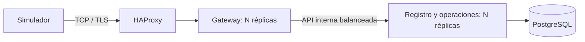

# Pasarela IoT TCP escalable - TFM BigSchool

Proyecto del Máster en Desarrollo con IA E.1. Recibe dispositivos mediante conexiones TCP persistentes con TLS, valida su identidad mediante HMAC y PostgreSQL, ejecuta sumas exactas y consulta totales. Incluye un simulador de dispositivos y configuración de réplicas con Docker Compose.

**Estado: MVP validado localmente y en GitHub Actions, con presentación y guion preparados para la revisión final del autor.** Los resultados comprobados y las limitaciones están en [Estado del proyecto](docs/estado-proyecto.md). Los comandos de validación están en [Pruebas reproducibles](docs/pruebas-reproducibles.md).

[Repositorio público](https://github.com/JrgPS/tfm-pasarela-iot) · [Presentación](https://github.com/JrgPS/tfm-pasarela-iot/blob/main/docs/entrega/Presentacion-TFM.pptx) · [GitHub Actions](https://github.com/JrgPS/tfm-pasarela-iot/actions)

## Problema y alcance

Separar la recepción de conexiones del acceso a datos permite replicar ambos servicios de manera independiente. El proyecto reproduce un flujo de comunicación IoT con datos ficticios; no procesa pagos ni datos de tarjetas.



Tres componentes funcionales y un balanceador adicional. Las conexiones abiertas permanecen en su gateway; tras una caída, el cliente reconecta y reintenta con el mismo identificador. PostgreSQL y el balanceador siguen siendo puntos de fallo únicos en este perfil.

## Tecnologías

C#/.NET 10, ASP.NET Core, sockets asíncronos y `SslStream`, HMAC-SHA-256, PostgreSQL 18, Npgsql, Docker Compose, HAProxy y xUnit. [Decisiones de implementación](docs/adr/0001-implementacion-inicial.md).

## Requisitos

- Para compilar: SDK .NET 10 compatible con `global.json`.
- Para el conjunto de contenedores: Docker Engine o Docker Desktop con contenedores Linux y Compose v2.
- Para las pruebas de integración: PostgreSQL real y una base de datos aislada cuyo nombre termine en `_tests`.

No se requiere una API de IA para ejecutar la aplicación. No hay servicios de pago obligatorios.

## Compilación y pruebas

Desde la raíz:

```bash
dotnet restore IotGateway.slnx
dotnet build IotGateway.slnx
dotnet test IotGateway.slnx
```

En el equipo inicial de Windows se ha descargado un SDK local ignorado por Git. Si `dotnet` no está en PATH, usar:

```powershell
.\scripts\Invoke-Dotnet.ps1 build IotGateway.slnx
.\scripts\Invoke-Dotnet.ps1 test IotGateway.slnx
```

Las tareas `TFM: compilar` y `TFM: pruebas` están preparadas para VS Code. Sin `IOT_TEST_CONNECTION`, xUnit omite explícitamente las pruebas de PostgreSQL; no significa que hayan pasado. Las pruebas TCP reales requieren además el conjunto Docker en marcha y `IOT_NETWORK_TESTS=true`.

Para ejecutarlas, definir `IOT_TEST_CONNECTION` con la cadena de una base de datos **de pruebas** y repetir `dotnet test`. Las pruebas crean tablas y datos ficticios y no se deben apuntar a una base de datos real del trabajo. La automatización de GitHub configura una base de datos desechable para ello.

## Arranque Docker

Procedimiento validado con contenedores Linux en Docker Desktop:

```bash
git clone https://github.com/JrgPS/tfm-pasarela-iot.git
cd tfm-pasarela-iot
```

```powershell
.\scripts\Start-Demo.ps1 -Devices 1000 -Gateways 1 -Registries 1
```

En Linux:

```bash
sh scripts/start-demo.sh
```

Los scripts generan secretos y un certificado de laboratorio, arrancan PostgreSQL, aplican el esquema y dan de alta dispositivos ficticios antes de levantar los servicios. Conservan los secretos y el manifiesto existentes; repetir `prepare --count` no amplía un manifiesto ya creado. No se borran datos al repetir el arranque.

Ejecutar el simulador cuando los servicios estén preparados:

```bash
docker compose run --rm --build simulator --host proxy --devices 1 --operations 5
docker compose run --rm simulator --host proxy --devices 100 --operations 10 --ramp-ms 20
```

El simulador conserva una conexión por dispositivo, valida HMAC y correlación, comprueba resultados y contrasta los totales antes/después. Escribe métricas JSON y CSV en `results/` y devuelve un código de salida distinto de cero si detecta fallos. `--synchronize-start true` mantiene los dispositivos conectados hasta que todos estén listos para empezar. Los perfiles mixtos de errores y las métricas separadas de todas las acciones todavía no están completos.

Escalado manual:

```bash
docker compose up -d --scale gateway=2 --scale registry=2 gateway registry proxy
docker compose ps
docker compose logs --tail 100 gateway registry proxy
```

Este comando no redistribuye conexiones abiertas. El gateway deja de aceptar conexiones al recibir SIGTERM, permite terminar operaciones y cierra las sesiones tras un plazo de drenaje; los clientes deben reconectar. SIGKILL no permite ese drenaje. Se ha verificado el descubrimiento DNS de las réplicas y el reparto de conexiones en Docker. La configuración admite hasta ocho destinos por servicio.

Validación completa y pruebas de caída:

```powershell
.\scripts\Test-Docker.ps1
.\scripts\Test-Docker.ps1 -IncludeAcceptance
.\scripts\Test-Backup.ps1
```

La opción de aceptación añade una prueba de unos diez minutos. [Metodología y límites](docs/pruebas-reproducibles.md).

Detener conservando datos:

```bash
docker compose down
```

## Configuración y seguridad

- `secrets/` se genera localmente y está excluido de Git y del contexto de imagen.
- Se generan `db-password`, `api-key`, `master-key`, `cert-password`, `server.pfx`, `server.cer` y `devices.json`. No imprimirlos ni subirlos al repositorio.
- El simulador verifica el certificado de laboratorio mediante su huella y el nombre del servidor; no desactiva indiscriminadamente la validación TLS.
- El certificado incluye `localhost`, `proxy`, `gateway` y `127.0.0.1`. Para otro nombre, configurar `TLS_DNS_NAME` al generar un certificado nuevo; no basta con cambiar el destino del simulador.
- La base de datos y la API interna no publican puertos del host en Compose. La entrada TCP se limita inicialmente a `127.0.0.1:7443`.
- El gateway solo recibe el certificado de servidor y el secreto de API interna. El servicio de registro custodia las claves cifradas de dispositivos.
- Un éxito se devuelve después de confirmar la transacción de operación, totales y auditoría. Si una respuesta se pierde tras commit, reintentar el mismo ID evita repetir el efecto.
- Durante una caída de PostgreSQL puede faltar auditoría en la base de datos; se registran causas operativas locales. No existe todavía un journal de reenvío duradero.

Variables principales: `IOT_SECRETS`, `TCP_PORT`, `MAX_CONNECTIONS`, `MAX_ACTIVE_REQUESTS`, `REGISTRY_URL`, `DB_HOST`, `DB_PORT`, `DB_NAME`, `DB_USER` y `ASPNETCORE_URLS`. Los secretos se leen desde archivos, no desde argumentos de línea de comandos.

## Protocolo y acciones

La [especificación completa](Doc/Especificacion-TFM-Pasarela-IoT.md) describe longitudes, fechas UTC, firma, códigos y pruebas de aceptación.

- `001`: inicializar una conexión y obtener el comercio del dispositivo autenticado.
- `002`: sumar dos operandos con signo y once dígitos, representados como enteros con escala 100.
- `003`: consultar número de sumas aceptadas y acumulado del dispositivo.

Cada línea ASCII termina en LF y está limitada a 4096 bytes. Un `request_id` único correlaciona las respuestas y permite deduplicar operaciones entre réplicas. No se usan decimales binarios en el cálculo.

## Estructura

| Ruta | Contenido |
|---|---|
| `src/Iot.Protocol` | Formato, HMAC, delimitación TCP y contratos |
| `src/Iot.Gateway` | Entrada TCP/TLS y comunicación con registro |
| `src/Iot.Registry` | API interna, autenticación, operaciones e idempotencia |
| `src/Iot.Persistence` | Npgsql, esquema y cifrado de claves |
| `src/Iot.Provisioning` | Secretos, certificado y datos ficticios |
| `src/Iot.Simulator` | Clientes persistentes concurrentes y comprobación funcional |
| `tests/Iot.Tests` | Pruebas de protocolo y PostgreSQL |
| `deploy` y `compose.yaml` | Imágenes y balanceador |
| `Doc` | Requisitos de BigSchool y especificación |
| `docs` | Decisiones, uso de IA y estado real |

## Preparación de la entrega

Los [materiales de entrega](docs/entrega/README.md) incluyen presentación editable, guion de demostración y datos para el formulario. La [validación de fallos](docs/validacion-fallos.md) comprueba caída de PostgreSQL y rechazo por capacidad con recuperación consistente. El repositorio es público y [ambos trabajos de CI terminaron correctamente](https://github.com/JrgPS/tfm-pasarela-iot/actions/runs/38774773520). Pendientes: revisión final del autor, decidir si se añade una grabación y envío del formulario. No hay URL pública de despliegue. Los resultados medidos y los límites se detallan en el estado del proyecto.

La documentación y las pruebas deben permitir al alumno comprender y defender las decisiones; véase [Uso de IA](docs/ai-development.md).
